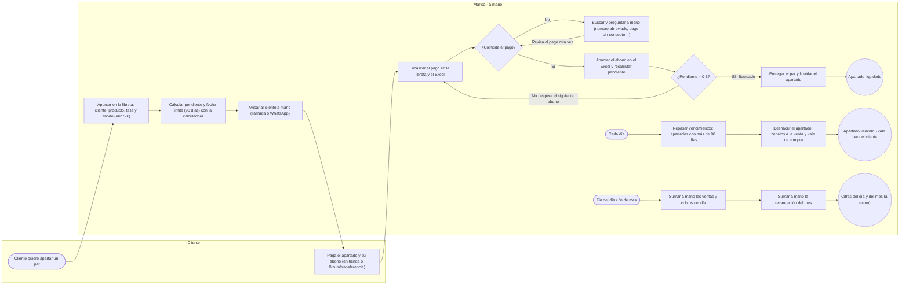
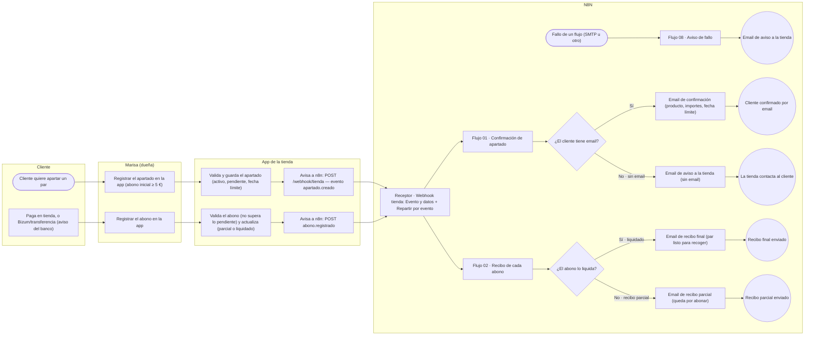

# Mapa BPMN del proceso de apartado (hoy vs automatizado)

> **US-20** ([issue #38](https://github.com/IA-P1-BCN/g1-n8n/issues/38)) · entregable 1 del enunciado.
> Vocabulario: [`GLOSSARY.md`](../../../GLOSSARY.md). Reglas del apartado: [`business-rules.md`](../business-rules.md).

Dos diagramas BPMN 2.0 (abrible en [bpmn.io](https://demo.bpmn.io), Miro o Excalidraw):

| Fichero | Qué dibuja |
|---|---|
| [`proceso-hoy.bpmn`](proceso-hoy.bpmn) | El proceso **actual**: libreta, Excel y calculadora; avisos del banco revisados a mano |
| [`proceso-automatizado.bpmn`](proceso-automatizado.bpmn) | El proceso **con n8n**: la app de la tienda y los flujos construidos (Receptor · Webhook tienda, Flujos 01, 02 y 08) |

## Qué cambia con n8n (resumen para la presentación)

| Hoy (a mano) | Con los flujos de n8n |
|---|---|
| Marisa apunta cada apartado en la **libreta** y calcula pendiente y plazo a 90 días con la **calculadora** | La **app** calcula pendiente y fecha límite al apartar (reglas del abono mín. 5 € y plazo 90 días se aplican solas) |
| El aviso del **banco** (Bizum/transferencia) se localiza a ojo en la libreta: nombres abreviados, pagos sin concepto… | El evento llega por webhook (`POST /webhook/tienda`) y son los datos de la app los que aparecen en el correo, sin recalcular nada |
| Cada abono se copia a mano al Excel y se recalcula lo pendiente | El **Flujo 02** envía el recibo (parcial o final cuando **liquidado**) en el momento del registro |
| Vencidos y cifras del día/mes se suman a mano: si se salta un día, un apartado **vence** sin que nadie lo vea | (Flujos 03 y 04, `apartado.vencido` y `venta.registrada`, son el siguiente paso: el Switch del Receptor ya las tiene preparadas) |
| Si algo falla (un correo no sale, un cobro se pierde) no hay rastro | El **Flujo 08** avisa a la tienda por email de cualquier fallo de un flujo (`errorWorkflow` en sus ajustes) |
| El cliente se entera de su apartado cuando Marisa lo llama | El **Flujo 01** manda la confirmación en segundos si hay email; si no, avisa a la tienda para llamar |

## Los mapas en Mermaid (se renderizan en GitHub)

Mismo contenido que los BPMN, en Mermaid para verlos sin salir del repo. **Cuando se cree o modifique un flujo de n8n, actualiza este bloque y el BPMN automatizado en la misma PR** (regla en [`AGENTS.md`](../../../AGENTS.md)).

### Proceso actual (a mano)

### Proceso automatizado con n8n

> El Switch «Repartir por evento» también tiene salidas `venta.registrada` y `apartado.vencido`: aún sin conectar (US-03/US-04 pendientes). Los Bizum/transferencia se revisan a mano: el flujo de abonos a distancia queda pendiente (nivel medio).

## Criterios de la historia

- [x] 1. Proceso **actual** dibujado (libreta, Excel, calculadora, avisos del banco a mano) — `proceso-hoy.bpmn`.
- [x] 2. Proceso **automatizado** con los flujos construidos — `proceso-automatizado.bpmn`.
- [x] 3. Diagrama **versionado en docs/** (BPMN 2.0, editable en bpmn.io y exportable a Miro/Excalidraw desde el propio formato).
