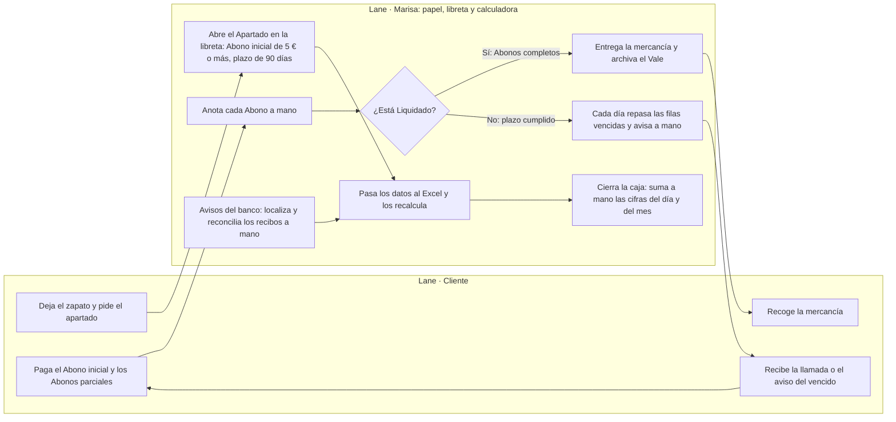
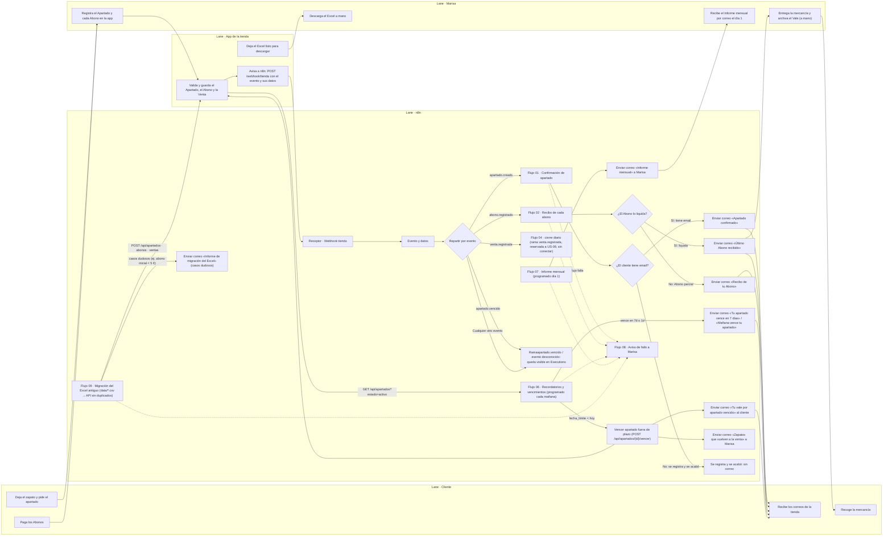

# Flujos del proceso · hoy vs automatizado

Los dos mapas del negocio en **Mermaid**: GitHub los pinta al abrir esta página, sin arrastrar ficheros.
Las reglas de negocio (Abono, Vale, Liquidado, plazo de 90 días…) están en [`docs/business/business-rules.md`](../business-rules.md).

## Proceso actual (íntegramente a mano)

Papel, post-its y memoria: quien no esté ese día no lo ve, y el Excel solo es fiel si Marisa lo actualiza a mano.

## Proceso automatizado con n8n

Bizum y transferencia se revisan aún a mano hasta el flujo de Abonos a distancia; el **Flujo 06** envía cada mañana los recordatorios a 7 y 1 día y vence por API los apartados fuera de plazo (entregando el Vale al cliente y avisando a Marisa de los zapatos que vuelven a la venta); el informe mensual (**Flujo 07**) se ejecuta el día 1 de cada mes; la migración puntual de las hojas antiguas (`data/*.csv`) corre en el **Flujo 09**; el aviso de fallo (**Flujo 08**) entra con `errorWorkflow`: todos los flujos lo apuntan en sus ajustes.
